# CET MCA Semester 1 C Programming Lab

*Foundational C programming and problem-solving laboratory coursework for First Semester MCA students at College of Engineering Trivandrum (CET).*

<!-- shieldcn-start -->
<p align="center">
  <a href="#"></a>
  <a href="#"></a>
</p>
<!-- shieldcn-end -->

---

## Lab Architecture & Curriculum Roadmap

The laboratory coursework progresses from fundamental terminal I/O and procedural logic to branching conditionals, data arrays, and structured computational routines:

```mermaid
flowchart TD
    subgraph S1 [Phase 1: Basic I/O & Sequential Flow]
        P1["01_HelloWorld.c<br/>(Standard Output)"]
        P2["02_InputName.c<br/>(String Buffers & Scans)"]
        P3["03_AddTwoNumber.c<br/>(Floating-Point Arithmetic)"]
    end

    subgraph S2 [Phase 2: Conditional Branching & Control Flow]
        P4["04_LargestOfTwoNumbers.c<br/>(Binary Comparison)"]
        P5["05_LargestOfThreeNumbers.c<br/>(Compound Relational Logic)"]
        P6["06_AreaOfRectangleSquareCircle.c<br/>(Menu-Driven Switch Dispatch)"]
    end

    subgraph S3 [Phase 3: Iteration & Composite Processing]
        P7["07_UserInfos.c<br/>(VLA Arrays, Accumulation & Statistics)"]
    end

    subgraph S4 [Phase 4: Arrays & Pointers]
        P8["08_ArrayInputDisplay.c<br/>(Array Input & Display)"]
        P9["09_ArrayPointerInputDisplay.c<br/>(Pointer Arithmetic)"]
        P10["10_MergeTwoSortedArrays.c<br/>(Sorted Merge)"]
    end

    subgraph S5 [Phase 5: Linked Lists & Dynamic Memory]
        P11["11_LinkedListStaticNodes.c<br/>(Static Nodes)"]
        P12["12_LinkedListArrayAlloc.c<br/>(Array-Allocated Nodes)"]
        P13["13_LinkedListManualNodes.c<br/>(Manual Node Linking)"]
        P14["14_LinkedListCreateDisplay.c<br/>(Create & Display)"]
        P15["15_LinkedListMenuDriven.c<br/>(Menu-Driven Operations)"]
        P16["16_LinkedListMenuDrivenWhile.c<br/>(While-Loop Menu)"]
    end

    subgraph S6 [Phase 6: Trees & Searching]
        P17["08_binary_search_tree.c<br/>(BST Insert, Delete & Search)"]
    end

    S1 --> S2 --> S3 --> S4 --> S5 --> S6
```



---

## Program Index

### Actual Lab Problems

| Program | Core Concept | Description |
| :--- | :--- | :--- |
| [`01_merge_sorted_arrays.c`](./01_Actual_Lab_Problems/01_merge_sorted_arrays.c) | Sorted Merge | Merges two user-input sorted integer arrays into a single sorted array. |
| [`02_array_operations.c`](./01_Actual_Lab_Problems/02_array_operations.c) | Array Insert/Delete/Search | Menu-driven array insertion, deletion, linear search, and display. |
| [`03_linked_list_operations.c`](./01_Actual_Lab_Problems/03_linked_list_operations.c) | Singly Linked List Operations | Menu-driven singly linked list with insertion/deletion at start, end, and position, search, and display. |
| [`04_stack_using_linked_list.c`](./01_Actual_Lab_Problems/04_stack_using_linked_list.c) | Dynamic Stack | Dynamic linked-list implementation of stack with push, pop, peek, and display. |
| [`05_queue_using_linked_list.c`](./01_Actual_Lab_Problems/05_queue_using_linked_list.c) | Dynamic Queue | Dynamic linked-list implementation of FIFO queue with enqueue, dequeue, and display. |
| [`06_circular_queue_using_array.c`](./01_Actual_Lab_Problems/06_circular_queue_using_array.c) | Circular Array Queue | Fixed-capacity circular queue using modular arithmetic with enqueue, dequeue, and display. |
| [`07_doubly_linked_list.c`](./01_Actual_Lab_Problems/07_doubly_linked_list.c) | Doubly Linked List Operations | Menu-driven doubly linked list supporting insertion/deletion at start, end, and position, and traversal. |
| [`08_binary_search_tree.c`](./01_Actual_Lab_Problems/08_binary_search_tree.c) | Binary Search Tree | Menu-driven binary search tree supporting insertion, deletion, searching, and inorder traversal. |

### Playground Programs

| Program | Core Concept | Description |
| :--- | :--- | :--- |
| [`01_HelloWorld.c`](./02_Playground/01_HelloWorld.c) | Console Output | Initializes program execution and prints text to standard output (`stdout`). |
| [`02_InputName.c`](./02_Playground/02_InputName.c) | String I/O | Reads formatted string input into a character buffer and displays greetings. |
| [`03_AddTwoNumber.c`](./02_Playground/03_AddTwoNumber.c) | Arithmetic Operations | Accepts double-precision floating-point inputs and computes their sum. |
| [`04_LargestOfTwoNumbers.c`](./02_Playground/04_LargestOfTwoNumbers.c) | Relational Logic | Compares two numeric values using `if-else` branching to identify the maximum. |
| [`05_LargestOfThreeNumbers.c`](./02_Playground/05_LargestOfThreeNumbers.c) | Multi-Condition Evaluation | Evaluates three numbers using compound logical operators (`&&`). |
| [`06_AreaOfRectangleSquareCircle.c`](./02_Playground/06_AreaOfRectangleSquareCircle.c) | Switch Selection | Computes geometric surface areas based on interactive user shape selection. |
| [`07_UserInfos.c`](./02_Playground/07_UserInfos.c) | Loops & Array Accumulation | Collects student marks into an array, calculates totals, averages, percentages, and eligibility status. |
| [`08_ArrayInputDisplay.c`](./02_Playground/08_ArrayInputDisplay.c) | Array I/O | Reads N elements into an array and displays them back. |
| [`09_ArrayPointerInputDisplay.c`](./02_Playground/09_ArrayPointerInputDisplay.c) | Pointers & Arrays | Performs array input and display using pointer arithmetic. |
| [`10_MergeTwoSortedArrays.c`](./02_Playground/10_MergeTwoSortedArrays.c) | Sorted Merge | Merges two sorted arrays into a single sorted array. |
| [`11_LinkedListStaticNodes.c`](./02_Playground/11_LinkedListStaticNodes.c) | Linked List Basics | Builds a static three-node linked list and prints each value. |
| [`12_LinkedListArrayAlloc.c`](./02_Playground/12_LinkedListArrayAlloc.c) | Dynamic Nodes | Links array-allocated nodes into a list and frees them. |
| [`13_LinkedListManualNodes.c`](./02_Playground/13_LinkedListManualNodes.c) | Manual Node Linking | Builds nodes with `malloc`, reading one value as input. |
| [`14_LinkedListCreateDisplay.c`](./02_Playground/14_LinkedListCreateDisplay.c) | Dynamic List | Creates an N-node list from user input and displays it. |
| [`15_LinkedListMenuDriven.c`](./02_Playground/15_LinkedListMenuDriven.c) | Menu-Driven List | Inserts at beginning/end and displays via an interactive menu. |
| [`16_LinkedListMenuDrivenWhile.c`](./02_Playground/16_LinkedListMenuDrivenWhile.c) | While-Loop Menu | Same menu-driven list controlled by a `while` loop. |

### Playground Practice & Scratch Files (Extras)

> [!NOTE]
> The following files in `02_Playground/` are exploratory practice drafts, learning experiments, and sandbox snippets written during lab sessions (some are partial or incomplete implementations).

| Program | Topic | Status & Description |
| :--- | :--- | :--- |
| [`extras_01_stack_using_linked_list.c`](./02_Playground/extras_01_stack_using_linked_list.c) | Stack via Linked List | Practice implementation with push, pop, peek, and display. |
| [`extras_02_basic_linked_list.c`](./02_Playground/extras_02_basic_linked_list.c) | Linked List Basics | Simple node allocation and linking demo. |
| [`extras_03_incomplete_linked_list.c`](./02_Playground/extras_03_incomplete_linked_list.c) | Linked List Draft | Scratch/in-progress linked list node input loop. |
| [`extras_04_incomplete_linked_list_menu.c`](./02_Playground/extras_04_incomplete_linked_list_menu.c) | Menu List Draft | Scratch/incomplete menu-driven insertion draft. |
| [`extras_05_empty_linked_list.c`](./02_Playground/extras_05_empty_linked_list.c) | Node Structure Skeleton | Practice starter skeleton for struct node pointers. |
| [`extras_06_basic_array.c`](./02_Playground/extras_06_basic_array.c) | Array I/O Draft | Early practice array element input and print. |
| [`extras_07_array_pointer.c`](./02_Playground/extras_07_array_pointer.c) | Array Pointer Draft | Early practice reading array via pointer iteration. |
| [`extras_08_merge_arrays.c`](./02_Playground/extras_08_merge_arrays.c) | Array Merge Draft | Scratch experiment merging two unsorted/sorted inputs. |

---

## Compilation & Execution

All programs are written in standard C (C99/C11 compatible) and can be compiled using `gcc` or `clang`.

### Step 1: Compile

Run the compiler on the target source file:

```bash
gcc -Wall -Wextra -std=c11 02_Playground/01_HelloWorld.c -o 01_HelloWorld
```

### Step 2: Run

Execute the compiled binary directly in the terminal:

```bash
./01_HelloWorld
```

### Batch Build (Optional)

To compile all source files in one pass:

```bash
for file in 01_Actual_Lab_Problems/*.c 02_Playground/*.c; do
  gcc -Wall -std=c11 "$file" -o "${file%.c}"
done
```

---

## Execution Walkthrough

### Example 1: Menu-Driven Area Calculator (`06_AreaOfRectangleSquareCircle.c`)

```text
Please Enter What You Want To Find Area Of
If Circle Then Type C
If Rectangle Then Type R
If Square Then Type S
R
Enter length: 12.5
Enter width: 4.0
Area of Rectangle = 50.000000
```

### Example 2: Student Marks and Eligibility Processor (`07_UserInfos.c`)

```text
Enter Your Name: Ashfakh
Enter Your Age: 21
Enter Number Of Subjects You Have: 3
Enter marks for Subject 1: 85
Enter marks for Subject 2: 90
Enter marks for Subject 3: 95

----- Details -----
Name: Ashfakh
Age: 21
Number of Subjects: 3
Total Marks: 270
Average Marks: 90.000000
Percentage: 90.000000

As You're age is 18 and Equal Aged You are Eligible to vote
```

---

## Repository Structure

Two folders separate programs by purpose:

- `01_Actual_Lab_Problems/` — programs given by teachers in theory/lab classes for understanding concepts (not record programs).
- `02_Playground/` — own practice programs written for the lab record.

```text
.
├── 01_Actual_Lab_Problems/
│   ├── 01_merge_sorted_arrays.c             # Merging two sorted arrays into one
│   ├── 02_array_operations.c                # Menu-driven array insert, delete, search, display
│   ├── 03_linked_list_operations.c          # Singly linked list insert/delete at pos, search
│   ├── 04_stack_using_linked_list.c         # Dynamic stack with push, pop, peek, display
│   ├── 05_queue_using_linked_list.c         # Dynamic FIFO queue with enqueue, dequeue, display
│   ├── 06_circular_queue_using_array.c      # Array circular queue with modular indexing
│   └── 07_doubly_linked_list.c              # Doubly linked list insert/delete at pos, display
├── 02_Playground/
│   ├── 01_HelloWorld.c                       # Basic Hello World program
│   ├── 02_InputName.c                        # String buffer reading
│   ├── 03_AddTwoNumber.c                     # Double-precision addition
│   ├── 04_LargestOfTwoNumbers.c              # Two-variable comparison
│   ├── 05_LargestOfThreeNumbers.c            # Three-variable comparison
│   ├── 06_AreaOfRectangleSquareCircle.c      # Menu-driven shape area calculator
│   ├── 07_UserInfos.c                        # Student records and mark aggregation
│   ├── 08_ArrayInputDisplay.c                # Array input and display
│   ├── 09_ArrayPointerInputDisplay.c         # Array I/O via pointers
│   ├── 10_MergeTwoSortedArrays.c             # Merge of two sorted arrays
│   ├── 11_LinkedListStaticNodes.c            # Static 3-node linked list
│   ├── 12_LinkedListArrayAlloc.c             # Array-allocated linked nodes
│   ├── 13_LinkedListManualNodes.c            # Manually linked dynamic nodes
│   ├── 14_LinkedListCreateDisplay.c          # Create and display linked list
│   ├── 15_LinkedListMenuDriven.c             # Menu-driven linked list ops
│   ├── 16_LinkedListMenuDrivenWhile.c        # While-loop menu linked list
│   └── extras_*.c                            # Practice & exploratory sandbox files
└── README.md                                 # Coursework index and lab guide
```
